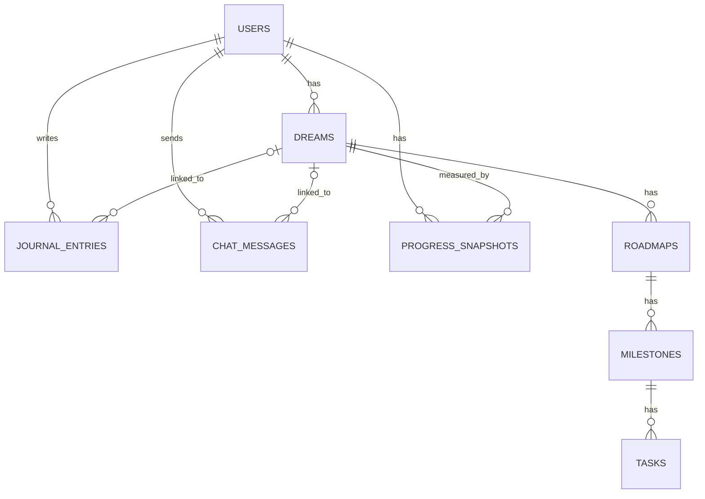

# Aspira – ER Diagram (M1 Database)

Owner: Ananya. Covers the 8 tables built in the two-week model.
Tables for evidence, resources, attachments, reminders and quiz attempts
are marked "Later" in the file structure and are not included here.

## Delete rules

- Deleting a user deletes their dreams, journal entries, chat messages and snapshots.
- Deleting a dream deletes its roadmaps, milestones, tasks and snapshots.
- Deleting a dream keeps journal entries and chat messages, but sets their `dream_id` to empty.
- Deleting a roadmap deletes its milestones and tasks.
- Deleting a milestone deletes its tasks.